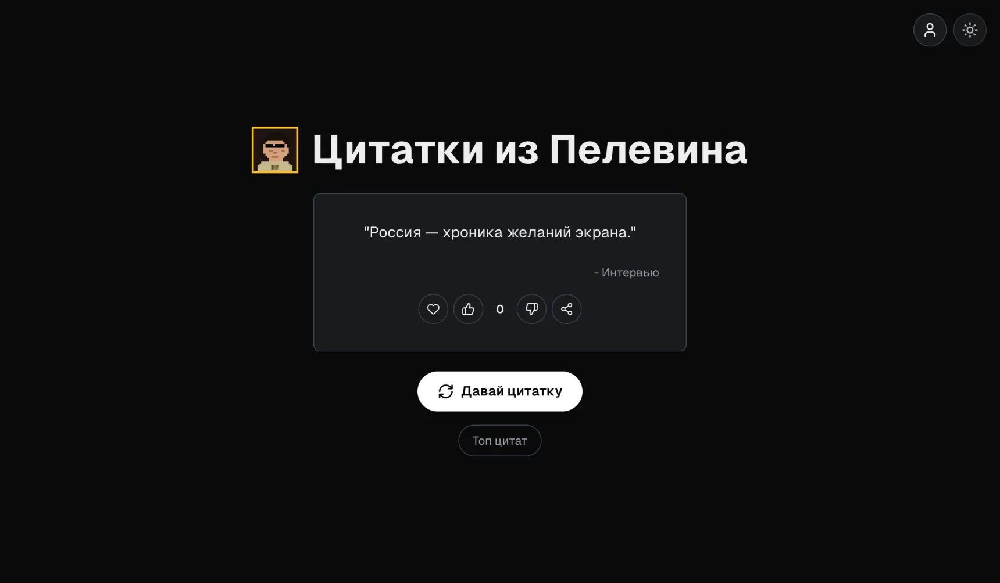
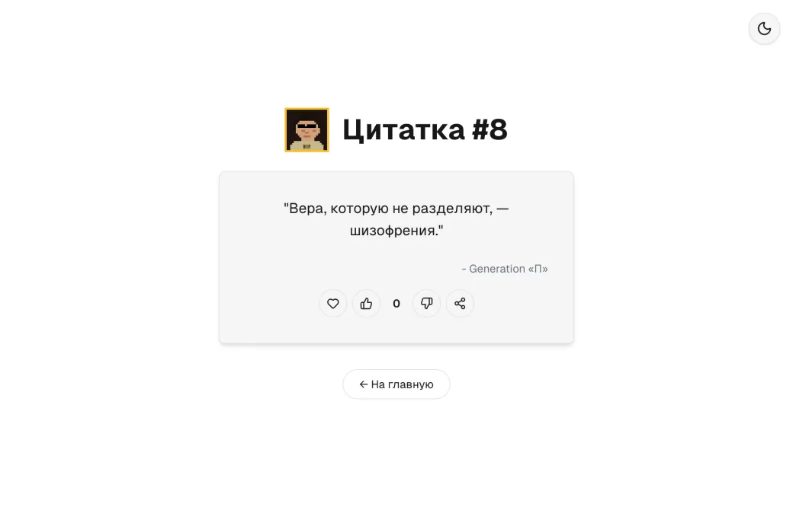
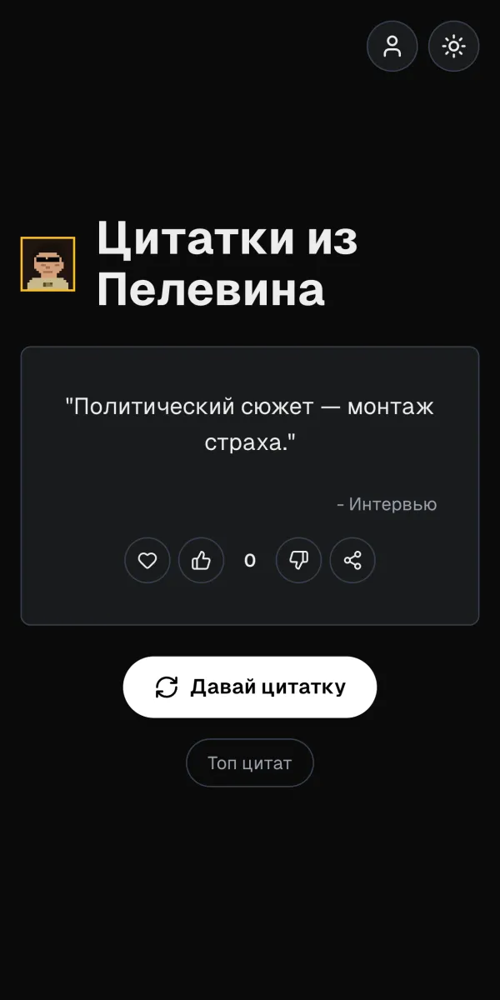

# 🕶️ Цитатки из Пелевина

**Reality is a rumour. Here's a quote to prove it.** One button, one sharp line from Victor Pelevin, zero illusions left.

### [🕶️ Open → pelevin-like.app](https://pelevin-like.app)

<picture>
  <source media="(prefers-color-scheme: dark)" srcset=".github/assets/desktop-dark.webp">
  <source media="(prefers-color-scheme: light)" srcset=".github/assets/desktop-light.webp">
  
</picture>

> *«Вера, которую не разделяют, — шизофрения.»* — Generation «П»
>
> A faith nobody shares is just schizophrenia. Share yours: there are 300 more where that came from.

## ✨ What it does

| | |
|---|---|
| 🎲 **One button, one epiphany** | Hit *Давай цитатку* (or the Space bar) for a random line from a library of 300 Pelevin quotes. |
| 🔗 **Share the enlightenment** | Every quote has its own link and a pixel-art preview card for Telegram, VK and X. |
| ❤️ **Keep the good ones** | Sign in with a magic link (no passwords, just your email) and bookmark quotes you want to quote back at people. |
| 👍 **Vote it up the void** | Plus the sharp ones, minus the empty ones. The best rise to the *Top* — this week and all-time. |
| 🌗 **Light or dark** | Follows your system, or flip it yourself. Generation «П» looks great in both. |
| 📱 **Pocket-sized** | Works on phone, tablet and desktop. |
| 🇷🇺 **Russian, of course** | The quotes are in the original Russian, and so is the interface: cool, sharp, compact. |

<table>
  <tr>
    <td align="center"> Every quote gets its own shareable page</td>
    <td align="center"> On your phone</td>
  </tr>
</table>

## 🗺️ How to use it

1. **Open** 👀 Go to [pelevin-like.app](https://pelevin-like.app).
2. **Press** 🎲 Tap *Давай цитатку*, or hit Space, until reality feels slightly less solid.
3. **Spread** 🔗 Share the one that hits, sign in to save it ❤️, and vote it up the [Top](https://pelevin-like.app/top) 👍.

## 🛣️ Roadmap

| Status | What |
|---|---|
| ✅ | 300 quotes, one random button, Space bar shortcut |
| ✅ | Shareable quote pages with preview cards for messengers and socials |
| ✅ | Passwordless magic-link sign-in, with mail that actually arrives |
| ✅ | Bookmarks that sync across your devices and tabs |
| ✅ | Quote voting and a public *Top* ranking, weekly and all-time |
| ✅ | Light and dark themes, phone to desktop |
| ✅ | A home of its own: [pelevin-like.app](https://pelevin-like.app) |
| 🚧 | AI-written Pelevin-style quotes, always clearly labelled as AI and kept apart from the real ones |
| 🔮 | One-tap sign-in with Google, Yandex or Apple |
| 🔮 | Passkeys: sign in with Touch ID, Windows Hello or a security key |
| 🔮 | Community quotes: submit your own Pelevin-like lines and climb the author ranking |
| 🔮 | *Human, book or AI?* A guessing game where sharp readers top the leaderboard |

## 🙌 Credits

- 📚 **The quotes** are by **Victor Pelevin**, taken from his novels, stories and interviews and used here as short citations with their source. All rights to the texts belong to the author and his publishers.
- 🕶️ **The pixel-art Pelevin** in sunglasses is a fan-made 8-bit tribute, not an official likeness.
- This is an independent fan project. It is **not affiliated with, endorsed by or connected to Victor Pelevin or his publishers.**

---

🔧 Technical notes for the maintainer live in [docs/](docs/DEVELOPMENT.md).

© Aydar Gazizullin — all rights reserved. See [LICENSE](LICENSE).
