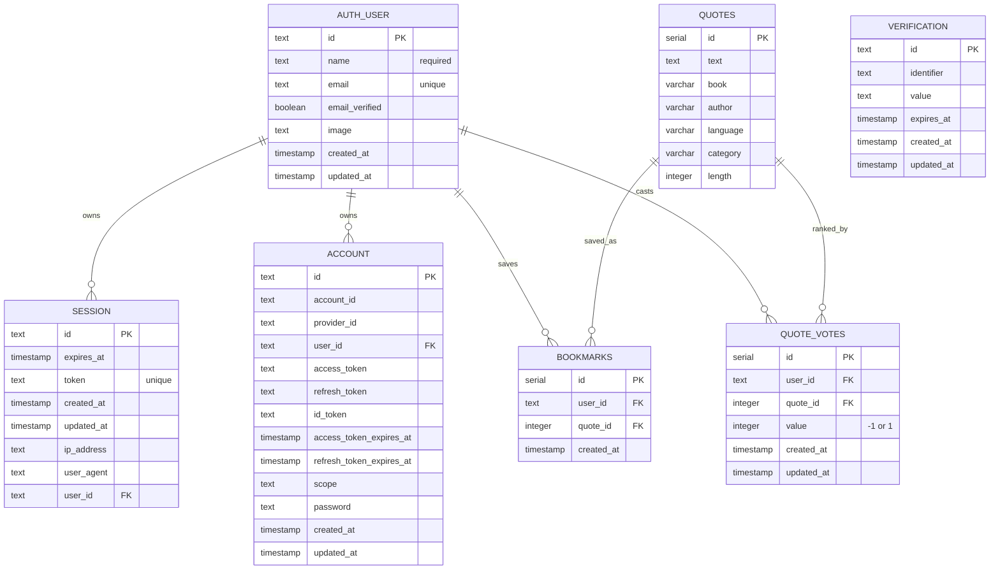
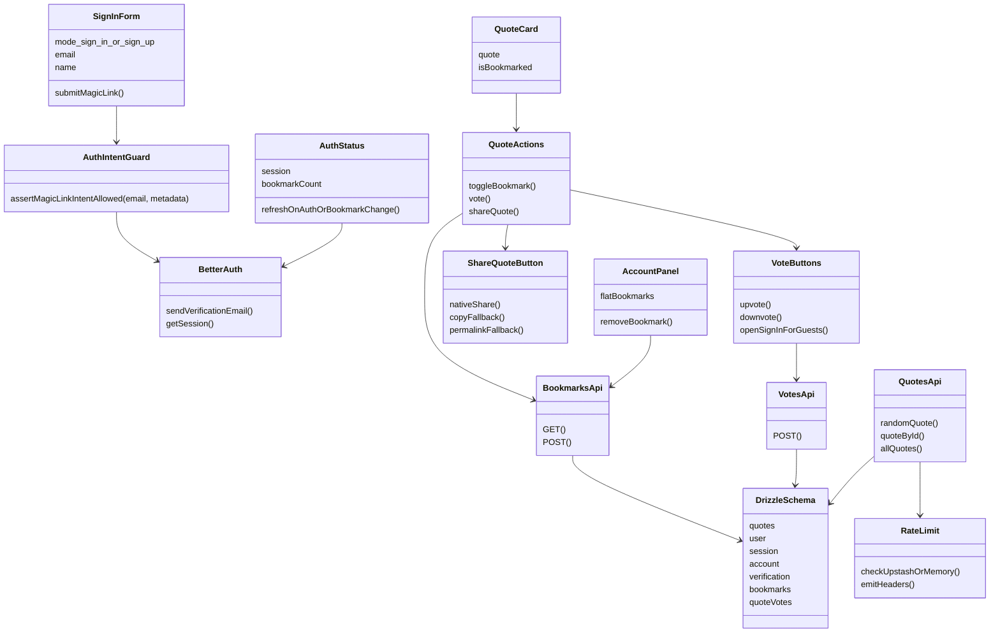
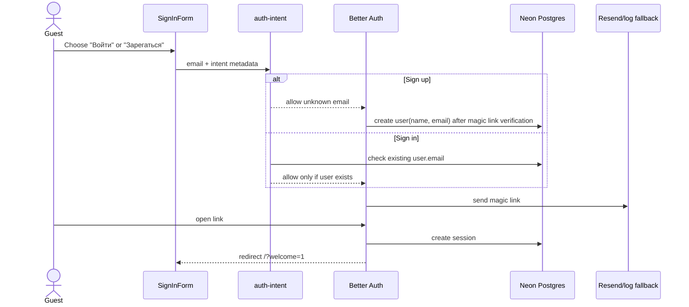
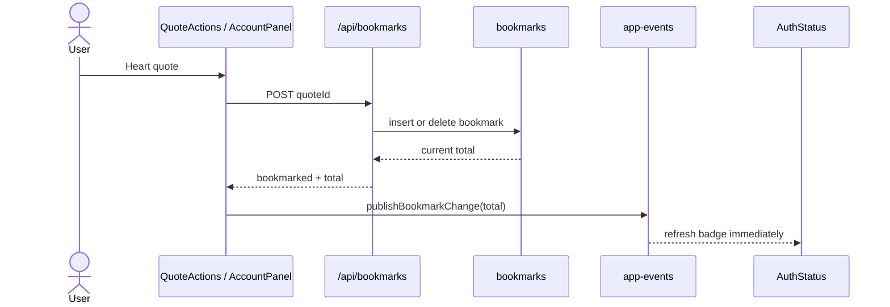
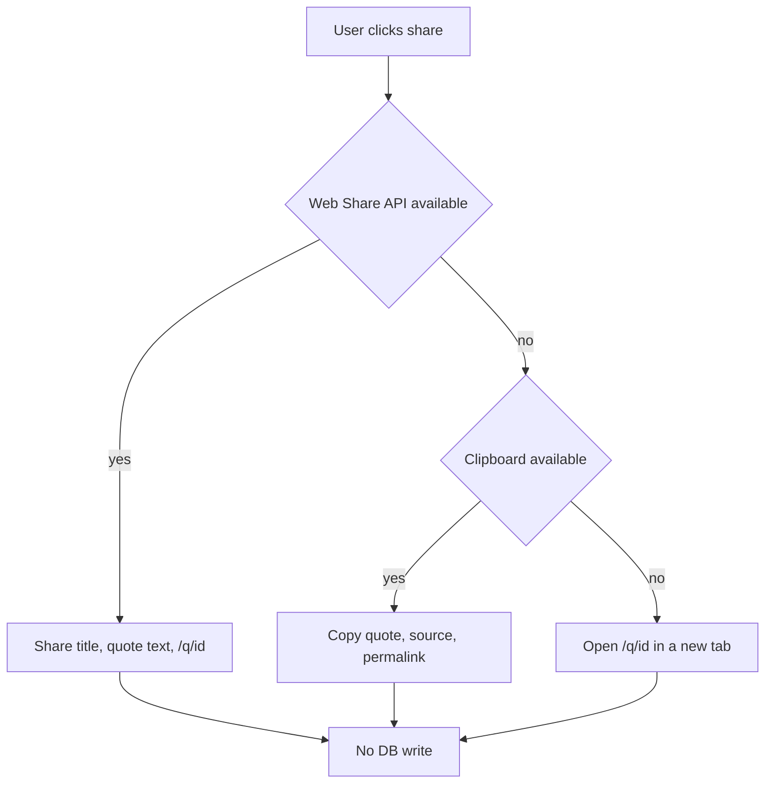
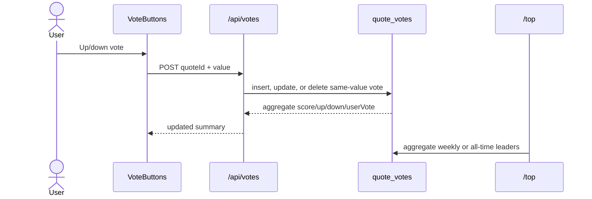
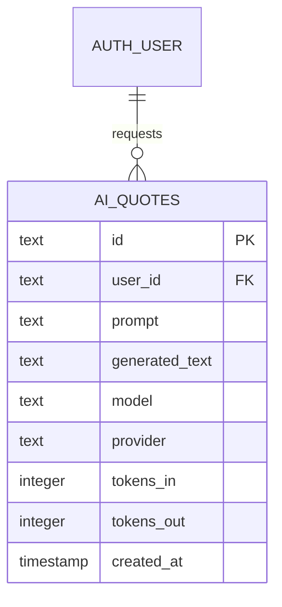

# Data Model & Visual Maps

This is the canonical visual map for persisted data, runtime data flow, and
module relationships. Keep it in sync with `lib/schema.ts`, route contracts,
and any feature that changes saved state.

## Current Decision

`main` now includes one new app-owned table: `quote_votes`, added by
`drizzle/0001_add_quote_votes.sql`. OAuth/passkeys are intentionally skipped
for now. AI generation and community submissions remain off `main`.

| Request | Current DB support | Notes |
| ------- | ------------------ | ----- |
| Signup asks for name once | `user.name text not null` | The UI sends `name` only in registration mode. Login stays email-only. |
| Login must not create unnamed users | `user.email` is unique and `user.name` is required | `lib/auth-intent.ts` blocks sign-in magic links for unknown emails. |
| Flat bookmarks list | `bookmarks` joins `user` to `quotes` | Book grouping is a UI choice and should not be encoded in the DB. |
| Bookmark count updates immediately | `bookmarks` is the source of truth | Client events revalidate the count; no denormalized counter column. |
| Sharing works from quote cards and bookmarks | `quotes.id` is stable | `/q/[id]` is the permalink; no share table is needed. |
| Cross-tab auth and bookmark sync | Browser event/localStorage bridge | This is client state synchronization, not persisted state. |
| Public quote ranking | `quote_votes` joins `user` to `quotes` | One vote per user/quote; value is checked to `-1` or `1`. |
| Random quote rate limiting | Upstash REST or memory bucket | No Postgres table; production can set Upstash env vars. |
| AI quote showcase remains off `main` | No AI tables on `main` | Future generated quotes should use a separate table before merging. |

## Live Database Audit

Last read-only check: 2026-06-16 against the configured Neon database from
`.env.local`.

| Check | Result |
| ----- | ------ |
| `user.name` | `text not null` - signup names are persisted. |
| `user.email` | Unique index `user_email_unique` exists. |
| `bookmarks.user_id` | `text not null`, FK to `user.id`, `ON DELETE CASCADE`. |
| `bookmarks.quote_id` | `integer not null`, FK to `quotes.id`, `ON DELETE CASCADE`. |
| `bookmarks_user_quote_idx` | Unique btree index on `(user_id, quote_id)` exists. |
| Share permalinks | Backed by `quotes.id`, the quote primary key. |
| `quote_votes` | `0001_add_quote_votes.sql` applied; FKs cascade to `user` / `quotes`, `value` is checked to `-1` or `1`, and unique `(user_id, quote_id)` exists. |

## Entity Relationship Diagram



## Table Contracts

| Table | Owner | Contract |
| ----- | ----- | -------- |
| `quotes` | App | Canonical quote dataset seeded from `scripts/quotes.json`. Do not mix AI-generated content into this table. |
| `user` | Better Auth + app signup policy | Account profile. `name` is required because registration collects it once. |
| `session` | Better Auth | Active browser sessions. Deletes cascade from `user`. |
| `account` | Better Auth | Auth provider account records. Deletes cascade from `user`. |
| `verification` | Better Auth | Magic-link tokens and verification state. |
| `bookmarks` | App | User-saved quotes. `(user_id, quote_id)` is unique; deletes cascade from both parent tables. |
| `quote_votes` | App | Public ranking votes. `(user_id, quote_id)` is unique; `value` is checked to `-1` or `1`; deletes cascade from both parent tables. |

## Runtime Module Map



## Signup And Login Flow



## Bookmark Flow



## Share Flow



## Vote And Ranking Flow



## Random Quote Rate Limit Flow

```mermaid
flowchart TD
  A[/api/randomQuote] --> B{Upstash env vars set}
  B -->|yes| C[Upstash REST pipeline: INCR + EXPIRE]
  B -->|no| D[In-memory bucket]
  C --> E{Allowed}
  D --> E
  E -->|yes| F[Fetch random quote]
  E -->|no| G[Return 429 + Retry-After]
```

## Planned AI Extension

The local branch `feat/ai-quote-generation` is intentionally not merged into
`main`. If generated quotes ship, add a separate table instead of storing them
inside `quotes`.



Recommended invariants for that future table:

- Generated rows are clearly AI-authored in UI and Open Graph metadata.
- Canonical `quotes` remains human-curated source material only.
- Store model/provider and token counts for cost/debug visibility.
- Add rate limiting before making generation public.

## Planned Community Extension

The next feature candidate is community submissions plus a source-guessing game.
See [`docs/11-community-game.md`](./11-community-game.md) for the product spec.
The core data boundary is the same as AI generation: community submissions and
guessing state must live outside canonical `quotes`.

## Schema Change Checklist

1. Edit `lib/schema.ts`.
2. Generate a migration with `npm run db:generate`.
3. Review the generated SQL under `drizzle/`.
4. Add or update tests for every changed route/helper/component contract.
5. Update this document, `docs/03-database.md`, and README/doc indexes.
6. Run `npm run lint && npm run type-check && npm test && npm run build`.
7. Apply with `npm run db:migrate`; never use `db:push` on production.
