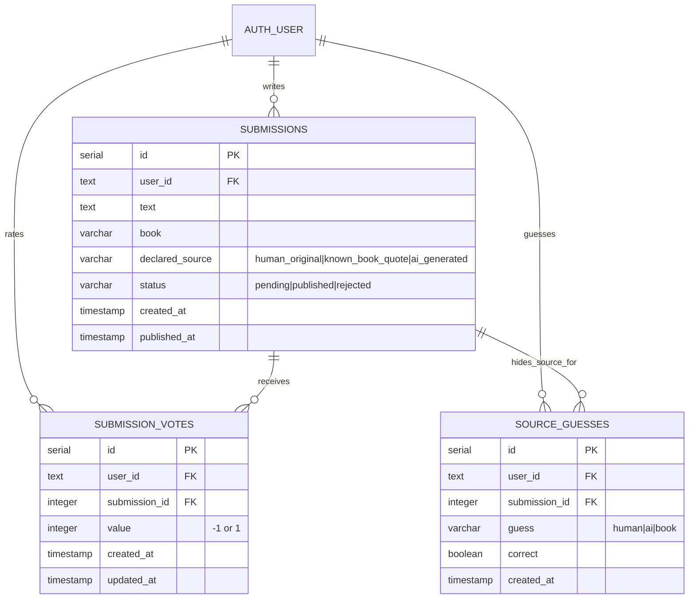

# Community Submissions & Guessing Game

Status: next feature candidate, not implemented yet.

## Pitch

Let signed-in users submit sharp Pelevin-like quotes, then turn moderation into
a game: people vote on quality and guess whether each submission was human or
AI-generated. Users rank not only by how well their quotes perform, but by how
accurately they detect the source of other quotes.

The important boundary stays the same: community and AI-generated material must
not pollute the canonical `quotes` table.

## Core Loops

### Submit

1. User writes a quote.
2. User marks source:
   - `human_original`
   - `known_book_quote`
   - `ai_generated`
3. If it is from a book, require book/source metadata.
4. Submission enters `pending`.
5. Lightweight moderation moves it to `published` or `rejected`.

### Vote Quality

Published submissions get up/down votes, separate from canonical quote votes.
The existing `/top` ranking can later gain tabs:

- `Канон` — current canonical `quote_votes`.
- `Народ` — community submissions by quality score.
- `Охота на ИИ` — source-guessing leaderboard.

### Guess Human Or AI

Users guess whether a published submission is AI-generated. The original
submitter's declared source is hidden until the round is resolved.

Scoring idea:

| Action | Score |
| ------ | ----- |
| Correct AI/human guess | `+1` |
| Correctly flag a known-book quote as not original | `+2` |
| Wrong guess | `0` |
| Submitter whose quote fools voters but passes moderation | bonus weighted by vote count |
| Submitter caught lying about source | penalty / temporary submission cooldown |

This creates two leaderboards:

- **Authors** — users whose submitted quotes get quality votes.
- **Detectives** — users who correctly identify AI vs human/community text.

## UX Notes

- Keep copy dry and direct: no classroom tone, no legalistic warnings.
- Suggested submit CTA: `Закинуть цитату`.
- Suggested guess labels:
  - `Человек`
  - `ИИ`
  - `Книга`
- Suggested result copy:
  - Correct: `Попал. Машину слышно.`
  - Wrong: `Мимо. Тут человек постарался.`
  - Needs more votes: `Приговор ещё варится.`

## Data Sketch

## Guardrails

- Rate-limit submissions per user.
- Require auth for submitting, voting, and guessing.
- Hide submitter identity during guessing to avoid social bias.
- Do not reveal the declared source until enough guesses are collected or a
  time window closes.
- Keep canonical `quotes` separate; accepted known-book quotes can be reviewed
  for manual import later, but never auto-promote.
- Add abuse controls before launch: report button, admin reject reason, and
  cooldowns for repeated low-quality or dishonest submissions.

## Rollout

1. Add schema and private API routes for submissions.
2. Add `/submit` and `/community` behind auth.
3. Add public community ranking after moderation exists.
4. Add source guessing after there is enough submission volume.
5. Add user profile/ranking page once scoring has useful data.
